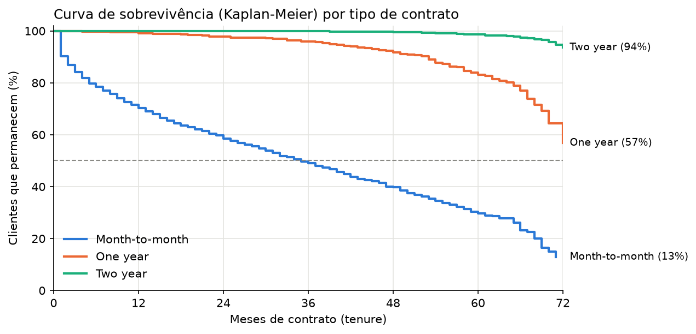
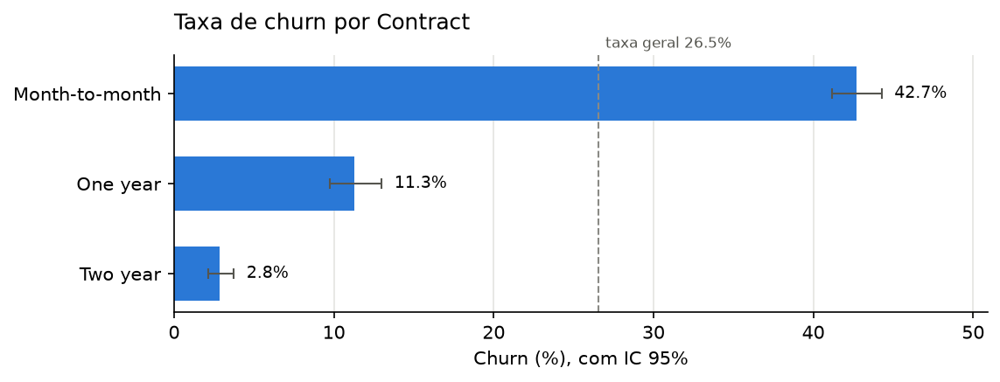

# Customer Churn — Telco

[](https://github.com/LorenzoNMachado/Customer-Churn/actions/workflows/ci.yml)
[-green.svg)](LICENSE)
[](SECURITY.md)

Análise estatística, análise de sobrevivência e modelos de previsão para entender quais clientes de uma operadora de telecom cancelam o serviço (churn) e quando.

**Dataset:** [Telco Customer Churn (Kaggle, blastchar)](https://www.kaggle.com/datasets/blastchar/telco-customer-churn): 7.043 clientes e 21 colunas. A taxa de churn é de 26,5%.

O CSV está versionado em `data/`. Os metadados do Kaggle identificam os arquivos como “Data files © Original Authors”; a licença MIT deste repositório cobre somente o código original. Consulte [Dados e licenças](DATA_SOURCES.md) antes de redistribuir o dataset ou resultados derivados.



## Principais resultados



| Variável | Maior churn | Menor churn |
|---|---|---|
| Contrato | Mensal: 42,7% (IC 95%: 41,2–44,3%) | Dois anos: 2,8% (2,1–3,7%) |
| Internet | Fibra óptica: 41,9% | Sem internet: 7,4% |
| Pagamento | Boleto eletrônico (electronic check): 45,3% | Cartão de crédito automático: 15,2% |
| Tempo de contrato | 0 a 6 meses: 54,3% | 66 a 72 meses: 6,1% |

- **Quando o cliente sai:** no contrato mensal, metade dos clientes já saiu aos 35 meses e só 13% chegam aos 72 meses. Nos contratos de um e de dois anos, a sobrevivência nunca cai abaixo de 50% (aos 72 meses, ficam 57% e 94%). As curvas diferem com folga (log-rank χ² = 2.353, p < 0,001).
- **Associações mais fortes** (V de Cramér): tipo de contrato (0,41), segurança online (0,35), suporte técnico (0,34) e tipo de internet (0,32). Gênero e serviço de telefone não têm associação com churn.
- **Modelos:** regressão logística, Random Forest e Gradient Boosting empatam na prática (ROC-AUC de 0,835 a 0,842 na validação cruzada). As variáveis derivadas (número de serviços e "sem proteção") não melhoraram o resultado. A regressão logística, a mais simples de interpretar, chega a **ROC-AUC 0,844 no teste**.
- **Calibração:** a calibração sigmoide reduziu o Brier score de 0,166 para 0,137. Com isso, um risco de 30% passa a significar de fato cerca de 30% de chance de cancelar.
- **Limiar de decisão:** com custos hipotéticos (ação de retenção = 1, perda do cliente = 5), a teoria indica agir a partir de um risco de 0,20 e a busca empírica chegou a 0,19. Com esse limiar, o modelo encontra 87% dos clientes que saem e o custo no teste cai de 1.450 (limiar 0,50) para 1.166.
- **Perfil de maior risco:** clientes novos, com fibra óptica e contrato mensal. São os três motivos que mais aparecem na explicação individual de cada cliente.

## Estrutura

```
data/              WA_Fn-UseC_-Telco-Customer-Churn.csv
notebooks/         analise_churn.ipynb (com saídas) e analise_churn.py (par do jupytext)
src/estatistica.py tabelas de frequência, medidas, testes, Kaplan-Meier e log-rank
src/modelagem.py   variáveis derivadas e explicação das previsões
tests/             testes do src/ (pytest)
reports/figures/   gráficos gerados pelo notebook
```

## Como rodar

Requer Python 3.12 ou mais novo.

```bash
python -m venv .venv
source .venv/bin/activate        # Windows: .venv\Scripts\activate
pip install -r requirements.txt
jupyter notebook notebooks/analise_churn.ipynb
```

- **Testes:** `pip install -r requirements.txt` e depois `pytest`. A cada push, o GitHub Actions roda os testes, confere o pareamento Jupytext e executa o notebook inteiro. O fluxo de qualidade estático não altera nem salva saídas no notebook.
- **Diffs legíveis:** o notebook é pareado com `notebooks/analise_churn.py` pelo [jupytext](https://jupytext.readthedocs.io). Com o jupytext instalado, o Jupyter atualiza os dois arquivos ao salvar. Fora do Jupyter, rode `jupytext --sync notebooks/analise_churn.ipynb`. Para revisar mudanças, olhe o diff do `.py`.
- **Dependências:** o Dependabot abre um PR quando sai uma nova versão de alguma biblioteca fixada.

## Licença e segurança

O código original está sob a [licença MIT](LICENSE). O dataset e seus direitos
permanecem separados. A política para relatos privados está em
[`SECURITY.md`](SECURITY.md); apenas a branch `main` é mantida.

## O que o notebook faz

1. **Tabelas de distribuição de frequência.** `tenure` (meses) usa faixas de 6 meses; `MonthlyCharges` e `TotalCharges` usam a regra de Sturges, com histograma. As categóricas aparecem numa tabela única.
2. **Medidas de posição e dispersão.** Média, mediana, moda pela fórmula de Czuber, desvio padrão, coeficiente de variação e quartis, com boxplots de quem saiu contra quem ficou.
3. **Taxa de churn por variável**, com intervalos de confiança de Wilson.
4. **Análise de sobrevivência.** Kaplan-Meier por tipo de contrato e teste log-rank.
5. **Testes de associação.** Qui-quadrado com V de Cramér e Mann-Whitney com rank-biserial.
6. **Modelos.**
   - Teste de variáveis derivadas.
   - Comparação de três modelos por validação cruzada.
   - Calibração das probabilidades.
   - Limiar de decisão pelo custo.
   - Explicação de cada previsão pelas contribuições de cada variável, que equivalem aos valores SHAP de um modelo linear.
